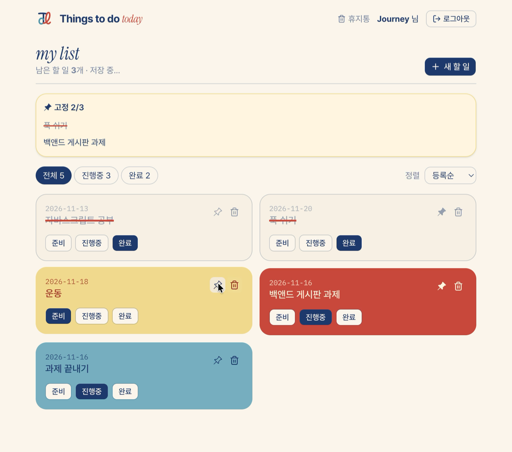
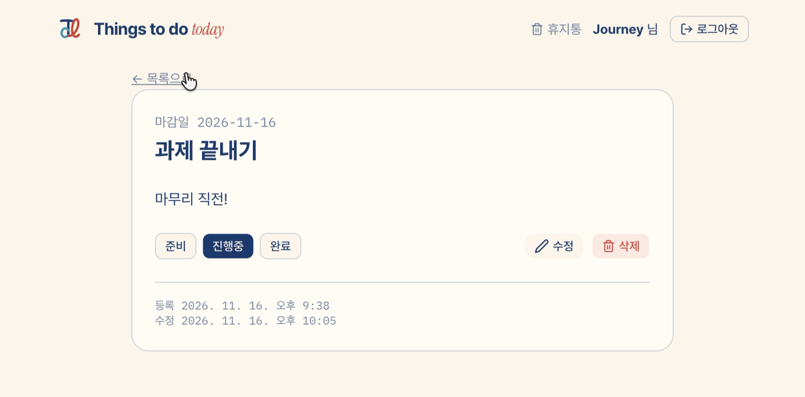
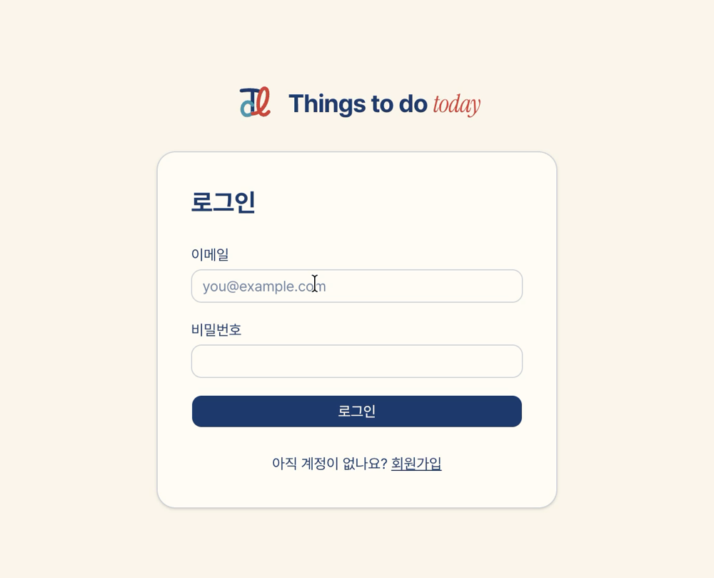
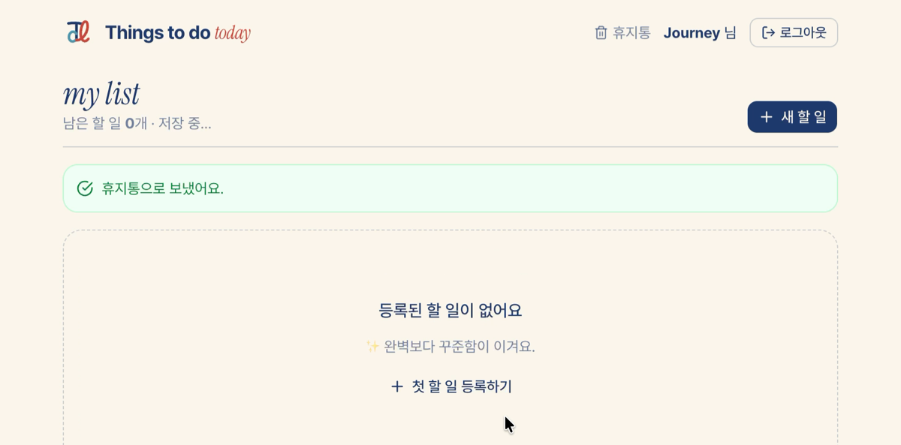
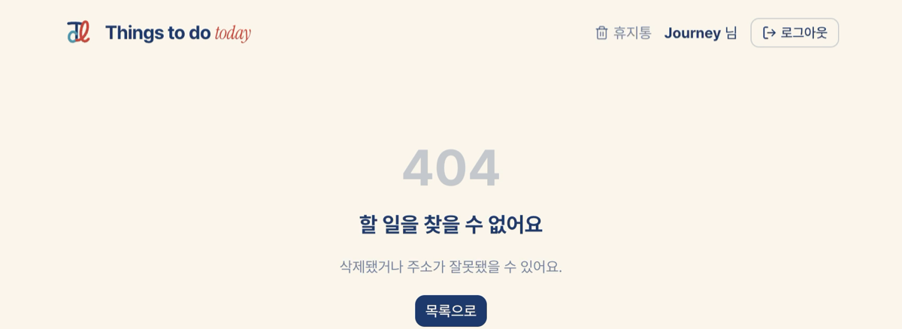

<h1 align="center">
  <br />
  Things to do <i>today</i>
</h1>

<p align="center">
  
  
  
  
  
  
  
</p>

<p align="center">
  <code>App Router</code> <code>Server · Client Components</code> <code>Server Actions</code> <code>Supabase Auth · RLS</code> <code>Dynamic Routes</code> <code>useOptimistic</code>
</p>

<p align="center">
  JavaScript로 만들었던 할 일 앱을 <b>Next.js + Supabase</b>로 옮긴 회원 전용 Todo 앱입니다.<br />
  로그인한 사람만 들어올 수 있고, 할 일은 DB에 저장되어 <b>어느 기기에서든</b> 이어서 볼 수 있습니다.<br />
  서버 · 클라이언트 컴포넌트를 역할에 맞게 나누고, 나눈 이유를 코드 주석에 남겼습니다.
</p>

<p align="center">
  🔗 <a href="https://things-to-do-today-next.vercel.app"><b>배포 사이트 바로가기</b></a>
  &nbsp;·&nbsp;
  📦 <a href="https://github.com/bsis09872-ux/things-to-do-today-next">GitHub 저장소</a>
</p>

<br />

| 📅 작업 기간       | 📝 과제                                                                |
| ------------------ | ---------------------------------------------------------------------- |
| 2026.11.13 ~ 11.16 | KANT AX 1기 프론트엔드 응용 (React/Next.js) · Todo 리스트 Next.js 전환 |

<br />

## ✨ 주요 기능

| 기능                   | 설명                                                                            |
| ---------------------- | ------------------------------------------------------------------------------- |
| 🔐 회원가입 · 로그인   | Supabase Auth. 로그인하지 않으면 모든 페이지가 로그인 화면으로 이동             |
| ➕ 할 일 등록 · 수정   | 제목(필수) · 마감일 · 메모. 서버에서 한 번 더 검사하고, 에러가 나도 입력값 유지 |
| 🔍 목록 · 상세         | 카드 목록, 제목을 누르면 상세 화면(`/todo/[id]`)                                |
| 🔄 상태 변경           | 준비 · 진행중 · 완료. 누르는 즉시 화면에 반영(낙관적 업데이트)                  |
| ✅ 완료 표시           | 카드가 종이색으로 바래고 빨간 굵은 취소선                                       |
| 🗂️ 필터 · 정렬 · 개수  | 전체 / 진행중 / 완료, 등록순 / 마감일순. 주소에 저장돼 새로고침해도 유지        |
| 📌 핀 고정             | 중요한 할 일 최대 3개를 따라다니는 상자에 고정                                  |
| 🗑️ 휴지통              | 삭제하면 휴지통으로 이동 → 복구 또는 영구 삭제                                  |
| 🌱 빈 상태 · 응원 문구 | 할 일이 없을 때 응원 문구 10개 중 하나                                          |

<br />

## ✅ 과제 조건별 구현 위치

| 구분 | 조건                         | 어디에 · 어떻게                                                                                         |
| ---- | ---------------------------- | ------------------------------------------------------------------------------------------------------- |
| 필수 | 컴포넌트 분리 · Props 전달   | `TodoDashboard` → `TodoItem` → `TodoStatusButtons`로 데이터는 내려주고, 이벤트는 함수 props로 올려받음  |
| 필수 | 인증 · 회원 전용 화면        | Supabase Auth + [`proxy.ts`](./proxy.ts) **허용 목록** 접근 제어 (등록되지 않은 페이지는 기본으로 잠김) |
| 필수 | Hook 기반 상태 · 비동기 연동 | `useState` · `useEffect` · `useActionState` · `useOptimistic` · `useTransition`                         |
| 필수 | 상태별 UI                    | 로딩(스켈레톤) · 성공(결과 안내) · 오류(`error.tsx` + 다시 시도) · 빈 데이터(응원 문구) · 404           |
| 필수 | 파일 기반 · 동적 라우팅      | `/` · `/todo/new` · **`/todo/[id]`** · `/todo/[id]/edit` · `/trash`, 라우트 그룹 `(auth)` · `(todo)`    |
| 심화 | 설계 품질 · 타입 · Hook 규칙 | 도메인별 폴더(`auth` · `todo`), 모든 props · 액션 결과에 타입(`ActionState<T>`), 의존성 배열 준수       |
| 심화 | 렌더링 방식 최적화           | 조회는 서버 컴포넌트, 클릭이 필요한 부분만 `'use client'`. **나눈 이유를 파일마다 주석으로** 남김       |

<br />

## 🛠️ 핵심 구현 포인트

| 구분                      | 내용                                                                                                                                     |
| ------------------------- | ---------------------------------------------------------------------------------------------------------------------------------------- |
| 🧱 서버 · 클라이언트 분리 | 데이터는 서버 컴포넌트(page)가 불러와 props로 넘기고, 버튼 · 폼처럼 상호작용이 필요한 부분만 클라이언트 컴포넌트로 분리                  |
| ⚡ 낙관적 업데이트        | `useOptimistic`으로 화면을 먼저 바꾸고, 서버가 실패하면 자동으로 원래대로. 받은 props를 그대로 기준으로 써서 서버 데이터와 어긋나지 않음 |
| 🛡️ 보안                   | 허용 목록 접근 제어, 오픈 리다이렉트 차단, 서버 액션마다 로그인 · 입력값 재검사, RLS + `user_id` 이중 확인                               |
| 🎨 디자인 토큰            | 1차 과제의 색 · 폰트 · 로고를 CSS 변수로 옮겨 shadcn/ui 테마 변수에 연결 → 색은 `globals.css` 한 곳에서 관리                             |

> 👉 폴더 구조와 코드 예시는 [구현 상세](./readme/implementation.md)에서 확인할 수 있습니다.

<br />

## 📸 스크린샷

<table>
  <tr>
    <th>목록</th>
    <th>상세 (동적 라우트)</th>
  </tr>
  <tr>
    <td valign="top"></td>
    <td valign="top"></td>
  </tr>
  <tr>
    <th>로그인</th>
    <th>빈 상태 · 404</th>
  </tr>
  <tr>
    <td valign="top"></td>
    <td valign="top">
      <br />
      
    </td>
  </tr>
</table>

<br />

## 🚀 실행 방법

**1. 설치**

```bash
git clone https://github.com/bsis09872-ux/things-to-do-today-next.git
cd things-to-do-today-next
npm install
```

**2. Supabase 준비**

- Supabase 프로젝트를 만들고 SQL Editor에서 [`supabase/schema.sql`](./supabase/schema.sql)을 실행합니다. (테이블 · RLS · 프로필 자동 생성 트리거)
- Authentication → Sign In / Providers → Email의 **Confirm email**을 끄면 가입 후 바로 로그인됩니다.

**3. 환경 변수** : 프로젝트 루트에 `.env.local`

```bash
NEXT_PUBLIC_SUPABASE_URL=your-project-url
NEXT_PUBLIC_SUPABASE_PUBLISHABLE_KEY=your-publishable-key
```

> publishable 키만 사용합니다. `service_role` · `secret` 키는 넣지 마세요.

**4. 실행**

```bash
npm run dev
```

[http://localhost:3000](http://localhost:3000)에서 확인합니다. 배포는 Vercel에 GitHub 저장소를 연결하고 같은 환경 변수 2개를 넣으면 됩니다.

<br />

## 📚 더 알아보기

<div align="center">
<table>
  <tr>
    <td align="center" valign="top" width="260">
      <br />
      <a href="./readme/implementation.md"><b>🛠️ 구현 상세</b></a>
      <br />
      <sub>폴더 구조 · 서버/클라이언트 분리 · 보안</sub>
      <br />
      <br />
    </td>
    <td align="center" valign="top" width="260">
      <br />
      <a href="./readme/troubleshooting.md"><b>🧯 트러블슈팅</b></a>
      <br />
      <sub>에러 · 버그 · 새로 시도한 방법</sub>
      <br />
      <br />
    </td>
    <td align="center" valign="top" width="260">
      <br />
      <a href="./readme/retrospective.md"><b>💭 회고</b></a>
      <br />
      <sub>어려웠던 점 · 배운 점</sub>
      <br />
      <br />
    </td>
  </tr>
  <tr>
    <td align="center" valign="top" width="260">
      <br />
      <a href="./readme/credits.md"><b>📎 출처 · 라이선스</b></a>
      <br />
      <sub>작업 도구 · 폰트 · 아이콘 · 라이브러리</sub>
      <br />
      <br />
    </td>
    <td align="center" valign="top" width="260">
      <br />
      <a href="https://github.com/bsis09872-ux/things-to-do-today"><b>📝 1차 과제 (JavaScript)</b></a>
      <br />
      <sub>이 앱의 원본 · 디자인 출처</sub>
      <br />
      <br />
    </td>
    <td width="260"></td>
  </tr>
</table>
</div>
